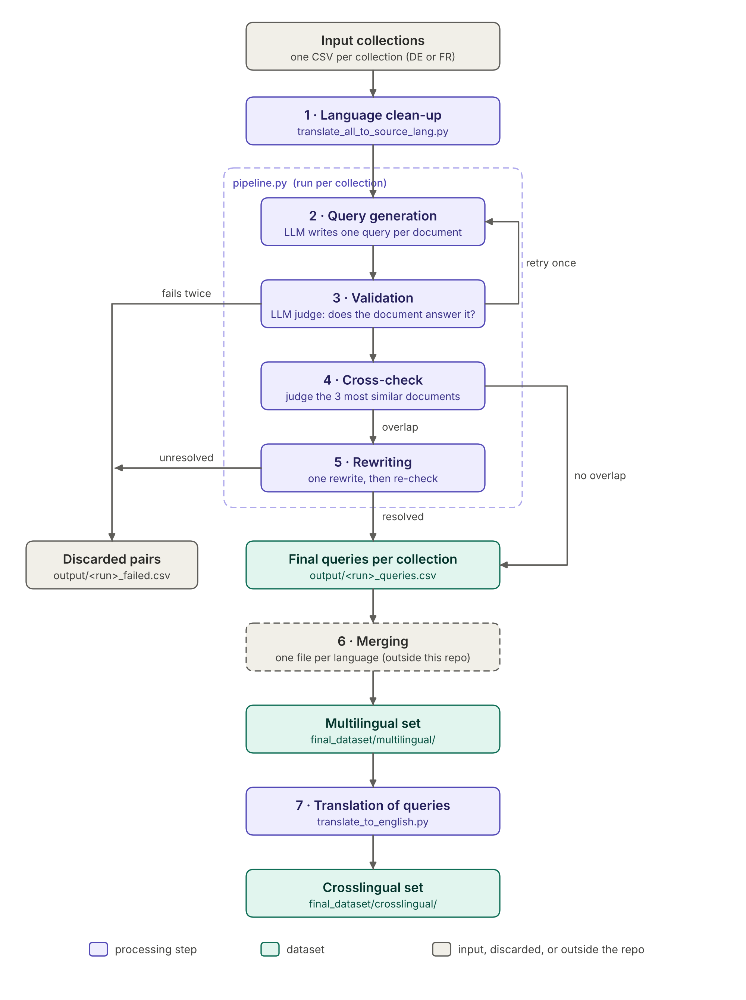

# Impresso IR test set

This repository contains an information retrieval (IR) test set built from
Impresso newspaper articles, and the pipeline used to build it. Each test item
is a pair of a search query and the one document that answers it. Queries are
generated and validated with an LLM, and checked against similar documents so
that each query points to its own document rather than to several.

The repository has three parts:

- `final_dataset/`: the released test set (German and French documents)
- `pipeline.py` and its modules: builds a test set from any CSV of documents
- `translation_scripts/`: language clean-up of input files and translation of
  queries to English

## Repository layout

```
├── final_dataset/
│   ├── multilingual/        queries in the language of the document
│   └── crosslingual/        English queries, same documents
├── prompts/                 LLM prompts (editable .txt templates)
├── translation_scripts/
│   ├── translate_all_to_source_lang.py
│   └── translate_to_english.py
├── input/                   put input CSVs here
├── in_process/              intermediate results (created by the pipeline)
├── output/                  final results (created by the pipeline)
├── docs/                    methodology diagram
├── config.py                models and settings
├── pipeline.py              entry point
├── precheck.py              checks the setup before a run
├── steps.py, llm.py, report.py
└── requirements.txt
```

## The dataset

Every file has one row per query–document pair:

| Column | Content |
|---|---|
| `id` | Impresso article id |
| `text` | article text |
| `query` | the query; the article in the same row is its relevant document |
| `SourceCorpus` | collection the article comes from |
| `relevanceScore`, `ocrQuality` | carried over unchanged from the input files |

| File | Documents | By `SourceCorpus` |
|---|---|---|
| `Impresso_IR_test_set_DE.csv` | 738 | USS_DE 461, Boxer_DE 277 |
| `Impresso_IR_test_set_FR.csv` | 725 | USS_FR 477, Olympics_FR 248 |

The `multilingual` and `crosslingual` versions contain the same documents in
the same order. They differ only in the `query` column: in `multilingual` the
query is in the language of the document (German or French); in `crosslingual`
it is the English translation of that query.

To use a file for evaluation, index the `text` column of all rows as the
corpus and use each `query` as a search query whose single relevant document
is the `id` in the same row.

## Usage

### Setup

Requires Python 3.10 to 3.13.

```bash
pip install -r requirements.txt
export LLM_API_KEY="sk-..."
export LLM_BASE_URL="https://api.openai.com/v1"   # optional; any OpenAI-compatible server
```

The pipeline, the precheck and the translation scripts all read these two
variables.

On Windows PowerShell, use `$env:LLM_API_KEY = "sk-..."` instead of `export`.

The embedding model (`Alibaba-NLP/gte-multilingual-base`) is downloaded from
Hugging Face on first use. It runs its own model code, so it is loaded with
`trust_remote_code=True`.

### Check the setup

```bash
python precheck.py
```

This checks that the API key and models work, that the embedding model loads,
and that every CSV in `input/` can be read, so put your input files there
first. It exits with code 1 if a check fails.

### Build a test set

The input is a CSV with a `text` column. An `id` column is optional; the row
number is used otherwise. All other columns are kept in the output.

```bash
python pipeline.py input/my_corpus.csv
```

Results are written to `output/`, where `<run>` is the input file name plus a
timestamp:

| File | Content |
|---|---|
| `<run>_queries.csv` | the test set: input rows whose query passed every check, plus `query` |
| `<run>_failed.csv` | discarded rows with `original_query`, `rewritten_query` and `fail_reason` |
| `<run>_rewrites.json` | each rewritten query with its neighbors, checks and outcome |
| `<run>_report.md` | statistics for every step |

The rows of `_queries.csv` and `_failed.csv` together equal the input rows.

Results are saved to `in_process/` after every step, so a run can continue
from a later step without repeating earlier LLM calls, for example after
editing a prompt:

```bash
python pipeline.py input/my_corpus.csv --start-from 3 --resume in_process/<run>_process2.jsonl
python pipeline.py input/my_corpus.csv --start-from 4 --resume in_process/<run>_process3.jsonl
```

### Configuration

Settings are in `config.py`. The main ones:

| Setting | Value | Meaning |
|---|---|---|
| `GEN_MODEL`, `JUDGE_MODEL` | `gpt-6-luna` | LLM for generating/rewriting queries and for judging |
| `REASONING_EFFORT` | `"none"` | reasoning off; set to `None` for servers without this parameter |
| `EMBED_MODEL` | `Alibaba-NLP/gte-multilingual-base` | embedding model for retrieval |
| `MAX_ATTEMPTS` | 2 | query generation attempts per document |
| `TOP_K` | 3 | retrieved documents checked per query |
| `MAX_REWRITE_ROUNDS` | 1 | rewrite rounds for queries that match other documents |
| `MAX_DOC_CHARS` | 32000 | characters of a document shown to the LLM |
| `EMBED_MAX_CHARS` | 6000 | characters of a document used for its embedding |
| `EMBED_BATCH_SIZE` | 8 | lower this if embedding runs out of memory |

The prompts are in `prompts/` as plain text files. Fields such as
`{{ document }}` are filled in by the script.

### Translation scripts

`translate_all_to_source_lang.py` makes each input file monolingual. It
detects the language of every text, takes the more frequent of German and
French as the file's language, and translates all other texts into it
(model: `gpt-6-sol`). Run it from the folder that contains the CSVs; results
go to an `output/` subfolder there:

```bash
cd path/to/csv_folder
python path/to/translation_scripts/translate_all_to_source_lang.py --column text
```

`translate_to_english.py` translates the `query` column of one file to
English (model: `gpt-6-luna`). Set `INPUT_FILE` and `OUTPUT_DIR` at the top of
the script, then run it from the repository root:

```bash
python translation_scripts/translate_to_english.py
```

Its default settings point at `final_dataset/`, so running it unchanged
overwrites the released crosslingual French file.

Both scripts check the result with `langdetect` and print texts that are not
in the expected language for a manual check.

## Methodology

The test set was built in the following stages. The numbers in the diagram
match the paragraphs below.

<p align="center">
  
</p>

**1. Language clean-up.** Each input collection was made monolingual with
`translate_all_to_source_lang.py`: texts not in the collection's dominant
language were translated into it.

**2. Query generation.** For each document, an LLM writes one query that the
document answers. The prompt asks for a specific fact or claim rather than the
general topic, phrased as a natural-language information need of 5 to 20
words in the language of the document, without copying phrases of more than
three words.

**3. Validation.** An LLM judge decides whether the document answers the
query. A document counts as relevant if it directly answers the query or
contains the key information to answer it; sharing the topic is not enough.
A query that fails is generated again. Documents without a valid query after
two attempts are discarded.

**4. Cross-check against similar documents.** All documents and queries are
embedded, and the three documents most similar to each query (excluding its
own) are retrieved. The same judge checks whether the query is also answered
by any of them. Queries that are not are kept as they are.

**5. Rewriting.** Queries answered by another document are rewritten once.
The rewrite prompt shows the target document and the three retrieved
documents, and asks for details that only the target document contains. The
rewritten query is then judged against its own document and, if it still
matches, retrieved and checked again. A query is discarded if its rewrite no
longer matches its own document or still matches another document.

**6. Merging.** The final queries of each collection were combined into one
file per language, with the collection recorded in `SourceCorpus`. This is
the `multilingual` set. This step was done outside the repository and is not
included in it.

**7. Translation.** The queries of the `multilingual` set were translated to
English with `translate_to_english.py`, giving the `crosslingual` set.

The same judge prompt is used in steps 3, 4 and 5, so relevance is defined
the same way throughout. The LLM is `gpt-6-luna` with reasoning turned off;
retrieval uses `gte-multilingual-base` on the first 6,000 characters of each
document.

### Limitations

- Each query has exactly one document marked as relevant. Other documents
  were only checked if they were among the three most similar documents to the
  query, so unchecked documents may still be relevant.
- Relevance was judged by an LLM; the judgments were not verified manually.
- The same LLM generates and judges the queries.
- Translations were checked automatically for their language with
  `langdetect`, not for their accuracy.